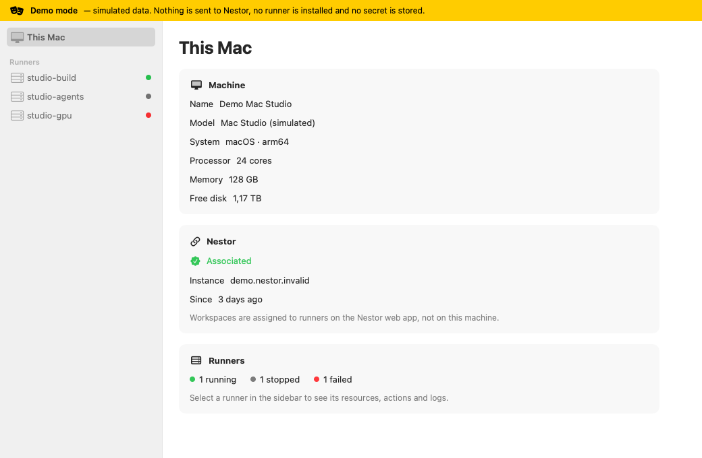
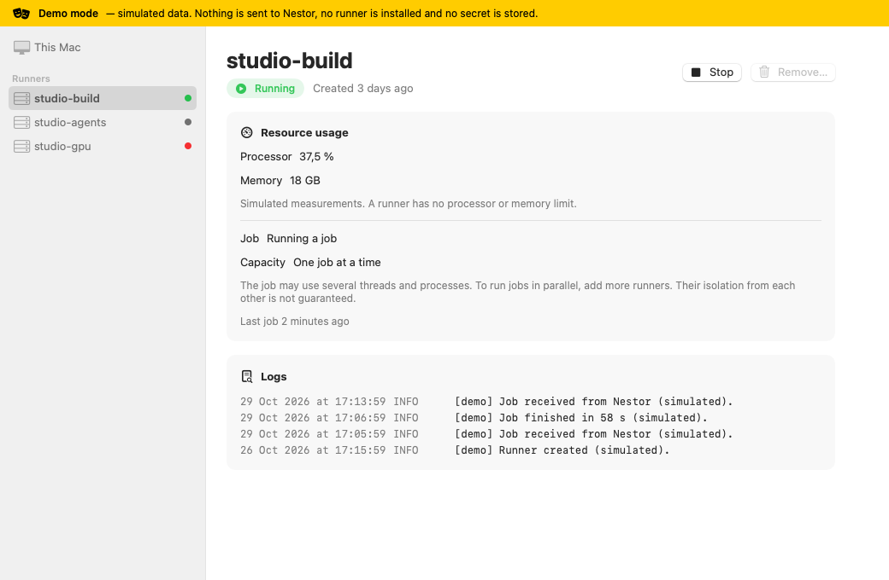
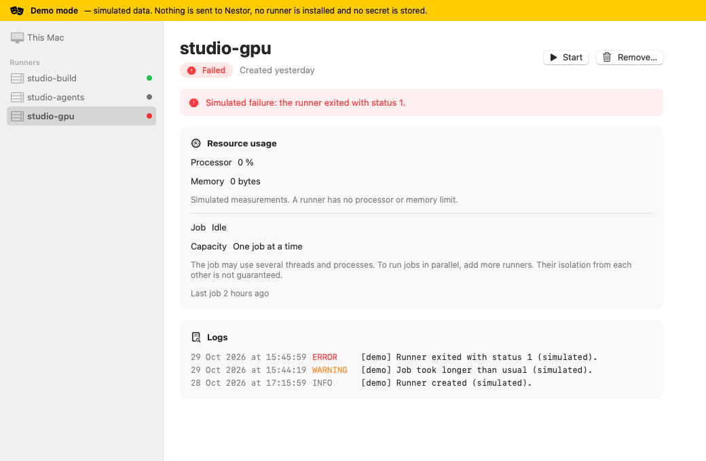
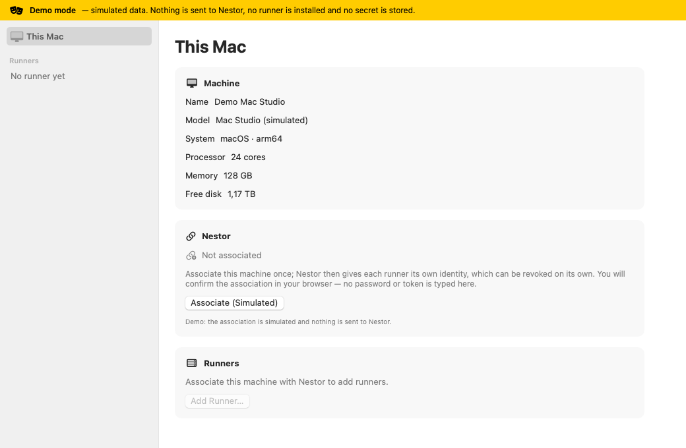
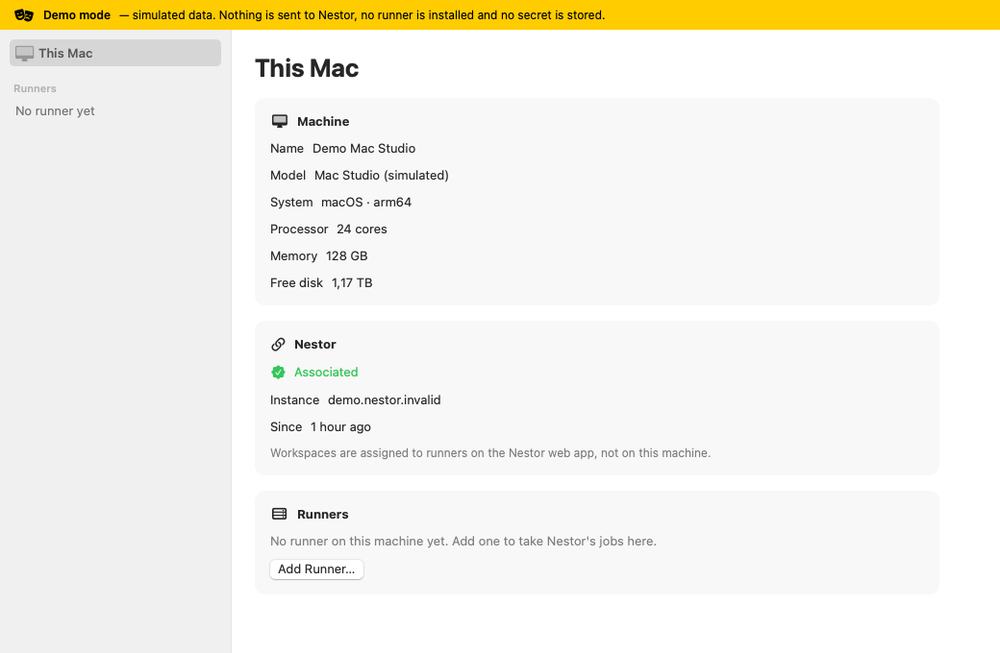
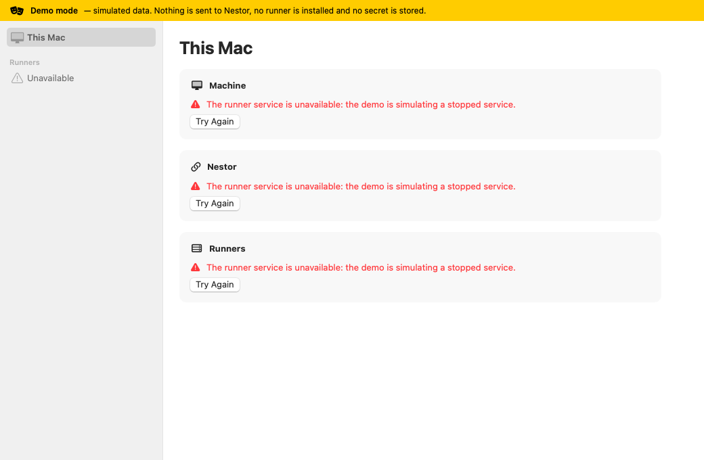
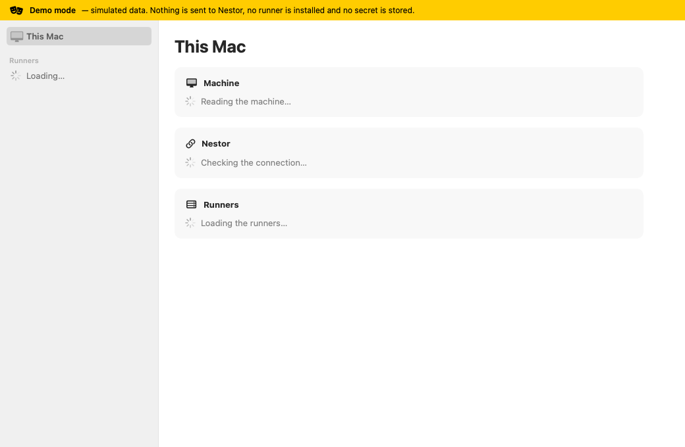

# Nestor Runner Manager

A desktop application to add, start, stop, remove and diagnose the Nestor runners of a machine. A runner is the program a machine runs to take Nestor's jobs.

> **Status: demo prototype.** This first version is a native macOS interface backed by **simulated data**. Nothing is sent to Nestor, no runner is installed or started, and no secret is asked for or stored. A yellow “Demo mode” banner is shown on every screen.



## What it does today

- **This Mac**: the machine, its association with Nestor and a summary of its runners.
- **Runners**: the list in the sidebar, with each runner's state.
- **A runner's page**: state, measured processor and memory usage, whether it is running a job, start / stop / remove actions and the logs.
- **Add a runner**: a name and whether to start it now.

A runner takes **one job at a time**, as the existing Nestor runner does; that job may use several threads and processes. To run jobs in parallel, add more runners — their isolation from each other is not guaranteed. A runner has no processor or memory limit: the figures on its page are measurements of what it uses, not caps (simulated in the demo).
- Loading, empty, not-associated and error states.

Workspaces are not assigned here: on the Nestor web app, a workspace is assigned to a runner or a pool of runners. The interface never asks for a password or a token; in the real version, the association is confirmed in the browser and Nestor issues each runner its own credential.

| Runner | Failed runner | Add a runner |
| --- | --- | --- |
|  |  |  |

| Not associated | No runner | Service unavailable | Loading |
| --- | --- | --- | --- |
|  |  |  |  |

## Repository layout

```
apps/macos/      macOS app (Swift, SwiftUI), a Swift package
  Sources/RunnerManagerKit/     models, the RunnerService contract, the demo service, the view model
  Sources/NestorRunnerManager/  the SwiftUI views
  Tests/RunnerManagerKitTests/  tests of the demo service and the view model
apps/windows/    future Windows client (empty)
apps/linux/      future Linux client (empty)
core/            future shared core in Rust: local service, runner supervision, OS integrations (empty)
docs/            architecture notes and screenshots
```

See [docs/architecture.md](docs/architecture.md) for how the interface is separated from the service.

## Build and run (macOS)

Requirements: macOS 14 or later, Apple Silicon first (the target machine is a Mac Studio), and Xcode 16 or later — or the Command Line Tools with Swift 6.

```sh
cd apps/macos
swift build                                   # debug build
swift test                                    # tests
swift run NestorRunnerManager                 # launch the app
swift run NestorRunnerManager --demo-scenario notAssociated
swift build -c release --arch arm64           # Apple Silicon release build
lipo -archs "$(swift build -c release --arch arm64 --show-bin-path)/NestorRunnerManager"   # → arm64
```

Demo scenarios (`--demo-scenario`): `populated` (default), `empty`, `notAssociated`, `unavailable`.

To regenerate the screenshots: `swift run NestorRunnerManager --snapshot ../../docs/screenshots`. Screens are rendered off-screen from the demo service.

You can also open `apps/macos/Package.swift` in Xcode and run the `NestorRunnerManager` scheme.

### Command Line Tools only, on macOS 27

The macOS 27 SDK of the Command Line Tools declares SwiftUI's `@State` as a macro whose plugin ships only with Xcode, and the tools do not load the Swift Testing macros on their own. Without Xcode, build against the macOS 26 SDK the tools also install, and pass the testing plugin:

```sh
export DEVELOPER_DIR=/Library/Developer/CommandLineTools
export SDKROOT=/Library/Developer/CommandLineTools/SDKs/MacOSX26.5.sdk
swift build
swift test -Xswiftc -load-plugin-library -Xswiftc /Library/Developer/CommandLineTools/usr/lib/swift/host/plugins/testing/libTestingMacros.dylib
```

## Continuous integration

`.github/workflows/macos.yml` builds, tests and makes an arm64 release build on GitHub's macOS runner for each pull request and each push to `main`. GitHub-hosted runners are free for public repositories.

## Next steps

1. Shared core in Rust (`core/`): a local service that supervises the existing Nestor runner — without rewriting it — and a `RunnerService` implementation in the macOS app that talks to it. How the app reaches the core (a command-line tool with JSON output or a local IPC) is still to be decided. First target: a real runner on the Mac Studio.
2. Real association with Nestor (browser confirmation), one identity per runner, individual revocation, credentials in the system keychain.
3. Start at boot without the interface open, tested across restarts.
4. Windows and Linux clients on the same core.

## License

No license has been chosen yet. Until one is added, the default copyright rules apply: the code is visible but not licensed for reuse.
